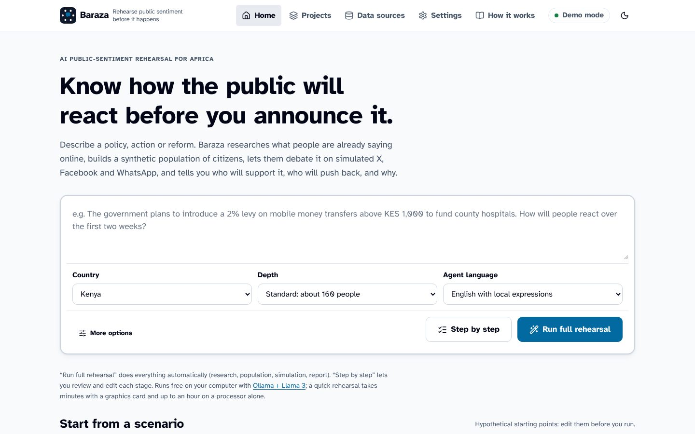
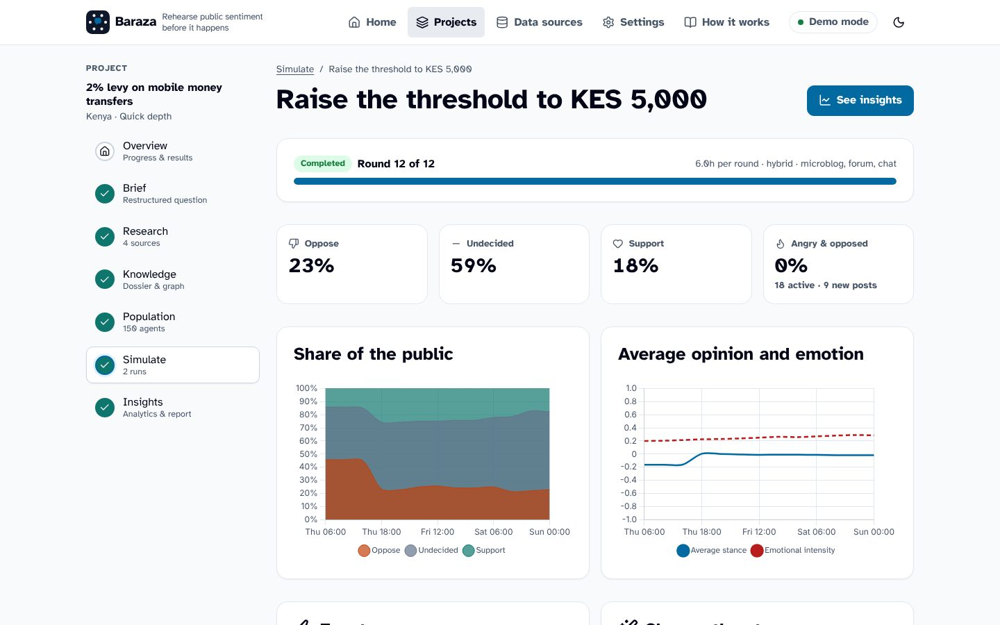
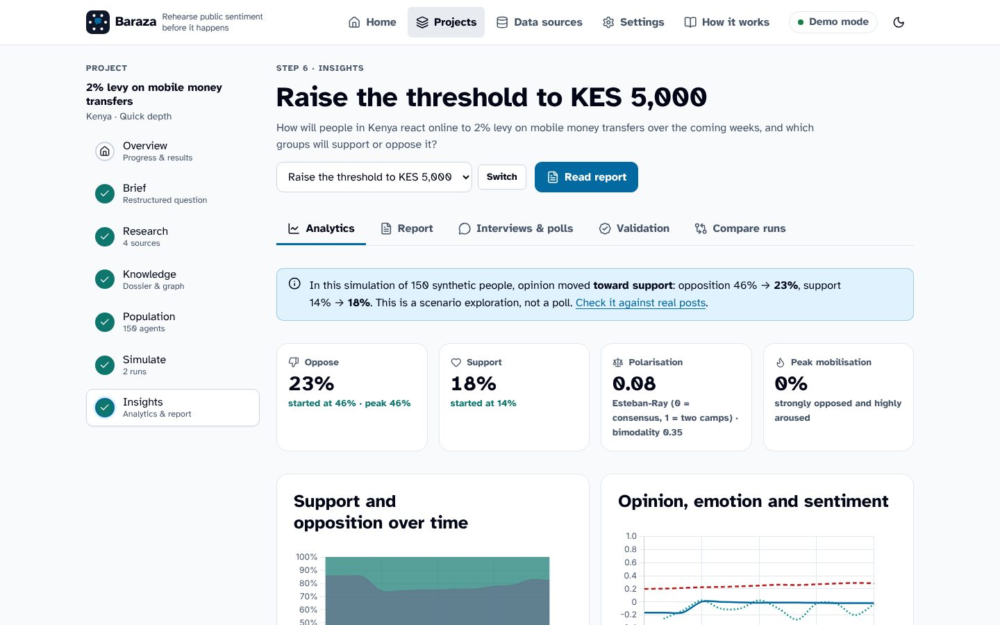
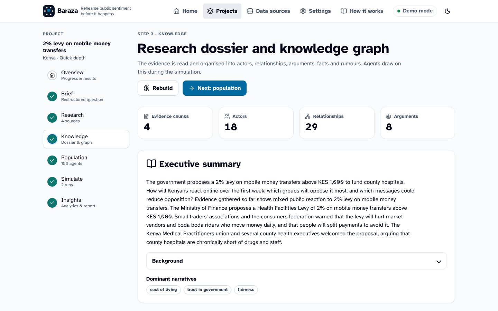
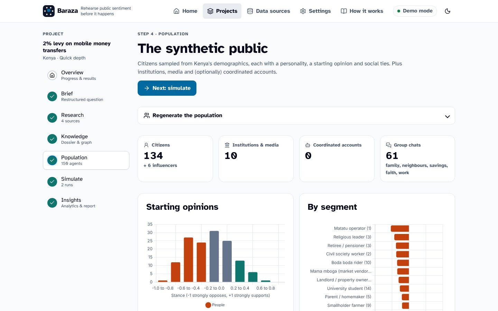
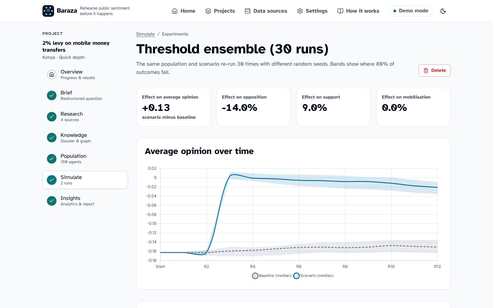
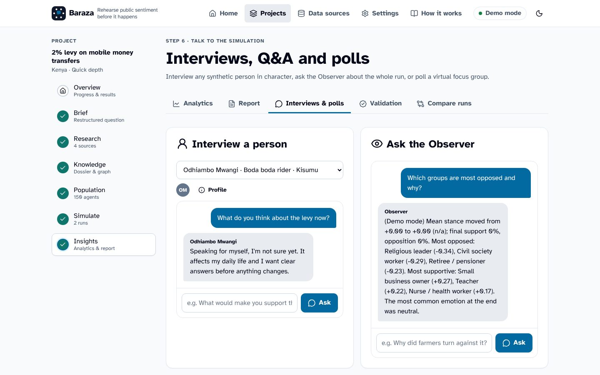

# Baraza: rehearse public sentiment before it happens

**Baraza** is a free, open-source tool that simulates how people react on social media to a policy, action or reform, so you can prepare before you go public. It is built for Kenya and the rest of Africa and runs fully on your own computer with the `llama3` model through [Ollama](https://ollama.com), at no cost.

A *baraza* is a public gathering where a community debates what affects it. This tool recreates that debate with AI agents: you write a proposal in plain English, Baraza researches what people already say about it online, builds a structured knowledge base, creates a synthetic population of citizens, institutions and media, and lets them argue, persuade each other and change their minds on an X-style microblog, a Facebook/Reddit-style forum and WhatsApp-style group chats. Then you can rehearse your communication: announce a concession, publish an explanation, inject a rumour and a fact-check, and compare what happens.

> Baraza explores *plausible dynamics*. It is not a poll and it does not predict what specific real people will do. See [How far to trust the results](docs/methodology.md#how-far-to-trust-the-results).



## Screenshots

<table>
<tr>
<td width="50%"><br><sub><b>Live simulation.</b> Support and opposition over simulated time, with events you inject.</sub></td>
<td width="50%"><br><sub><b>Insights.</b> Who moved, polarisation, echo chambers and which arguments worked.</sub></td>
</tr>
<tr>
<td><br><sub><b>Knowledge.</b> A cited dossier, the actors involved and the argument bank.</sub></td>
<td><br><sub><b>Population.</b> Synthetic citizens, institutions and media with evidence-based starting views.</sub></td>
</tr>
<tr>
<td><br><sub><b>Ensembles.</b> 30 runs of a concession versus the baseline, with uncertainty bands.</sub></td>
<td><br><sub><b>Talk to the simulation.</b> Interview any agent, question the Observer, poll a focus group.</sub></td>
</tr>
</table>

<sub>Screenshots from the offline demo (`python manage.py baraza_demo` with the built-in demo model and illustrative, not real, evidence). With Llama 3 the briefs, dossiers, posts and reports are written by the model.</sub>

## What it does

| Step | What happens |
|---|---|
| **1. Brief** | Your prompt is restructured into a research brief: the concrete measures, who proposes it, who is affected and how (direction and intensity), stakeholders, search queries (including Swahili for East Africa), hashtags and testable hypotheses. You can edit everything. |
| **2. Deep research** | Free sources first: web and news search, Google News country editions, the GDELT news index, Wikipedia, Reddit, YouTube comments, public Telegram channels, and public posts on X, Facebook, LinkedIn, TikTok and Instagram as indexed by search engines. Optional low-cost providers (Apify, twitterapi.io, Tavily, Brave, Serper, X API). Articles are read in full (robots.txt respected), ranked for relevance, and public posts are labelled for stance. |
| **3. Knowledge graph (GraphRAG)** | A language model extracts actors, relationships, arguments for and against, facts and rumours. Actors are merged ("KRA" = "Kenya Revenue Authority"), ranked with PageRank and grouped into communities. Baraza writes a neutral dossier, a stakeholder impact matrix and an argument bank. |
| **4. Synthetic population** | Citizens are sampled from country demographics (all 47 Kenyan counties from the 2019 census; regional data for Nigeria, South Africa, Ghana, Uganda, Tanzania, Rwanda and Ethiopia) and 25 local archetypes (boda boda riders, market vendors, students, farmers, civil servants, M-Pesa agents...). Each gets Big Five personality traits, platform habits and a starting opinion derived from how the research says their group is affected, optionally calibrated to the stance seen in real posts. Institutions and media from the knowledge graph become accounts. |
| **5. Simulation** | Agents wake up according to their habits, the time of day and how heated the topic is, read ranked feeds, update their opinions (social judgement theory with backfire, group polarisation and anchoring), react, reply and post. Language-model text for the most visible posts, instant templates for the rest. You can intervene live ("God mode"). |
| **6. Insights** | Opinion trajectories by segment and county, polarisation and echo-chamber indices, which arguments persuaded or backfired, influential accounts, a written Observer report, interviews with any agent, virtual polls, scenario comparison, Monte Carlo ensembles with confidence intervals, and validation against real posts. |

**Autopilot** runs all six steps from a single prompt. **Step-by-step mode** lets you review and edit each stage.

## Quick start

You need **Python 3.10 or newer** and, for AI features, **Ollama** with `llama3` (you can also try Baraza without any AI; see the demo below).

```bash
# 1. Get the code
git clone https://github.com/captain-g/agent-swarm.git baraza
cd baraza

# 2. Create a virtual environment and install
python -m venv venv
source venv/bin/activate            # Windows: venv\Scripts\activate
pip install -r requirements.txt

# 3. Create the database
python manage.py migrate

# 4. Make sure Ollama is running with llama3 (you already have this if `ollama run llama3` works)
ollama pull llama3
ollama pull nomic-embed-text        # optional: better search over the evidence

# 5. Start Baraza
python manage.py runserver
```

Open **http://127.0.0.1:8000**, type a proposal (or pick one of the 12 ready-made African scenarios) and press **Run full rehearsal**.

Check that the language model is reachable at any time with `python manage.py check_llm`, or open **Settings** in the app.

### Try it without any AI or internet

```bash
LLM_PROVIDER=fake python manage.py baraza_demo     # Windows PowerShell: $env:LLM_PROVIDER="fake"; python manage.py baraza_demo
LLM_PROVIDER=fake python manage.py runserver
```

This creates a complete worked example (a fictional 2% levy on mobile money transfers) using a built-in offline stand-in model. Its writing is deliberately plain; connect Ollama for real quality.

### Command line

```bash
python manage.py rehearse "The county government bans plastic bottles in all markets" --country KE --depth quick
```

## Running it for free (and cheaply when you want more)

| Setup | Cost | Notes |
|---|---|---|
| Ollama `llama3` + SQLite + free data sources | **KES 0** | The default. A quick rehearsal makes about 70 model calls, a standard one about 200. With a graphics card or an Apple Silicon Mac a standard rehearsal takes roughly 15-40 minutes; on a processor alone, start with Quick depth (up to an hour). |
| Hybrid: agents on local `llama3`, brief/dossier/report on a free hosted tier (Groq or OpenRouter free models) | **KES 0** within free limits | Set `HYBRID_SMART_TIER=True` and an `OPENAI_API_KEY`. Better analysis, same privacy for the bulk of calls. |
| Everything on a hosted API | Typically well under USD 0.50 per standard rehearsal on low-cost open models | Any OpenAI-compatible API: Groq, OpenRouter, Together, DeepSeek, Gemini, OpenAI. |
| Paid social data (X, LinkedIn, Facebook, TikTok) | Free monthly credits, then a few dollars per thousand posts | Apify, twitterapi.io or the official X API. Optional. |

Identical model requests are cached, the number of AI-written posts per round is configurable, and the **Instant** preset runs a whole simulation with no AI text at all in seconds. Details: [docs/cost-guide.md](docs/cost-guide.md).

## Data sources: free first

| Platform | Free option in Baraza | Low-cost option |
|---|---|---|
| News and web | DuckDuckGo/Bing metasearch, Google News country editions, GDELT, your RSS feeds, self-hosted SearXNG | Tavily, Brave, Serper free tiers |
| X (Twitter) | Public posts indexed by search engines; Bluesky and Mastodon for comparison | twitterapi.io (pay as you go), Apify, official X API |
| Facebook | Public posts and pages indexed by search engines | Apify Facebook scrapers for public pages |
| LinkedIn | Public posts indexed by search engines | Apify LinkedIn post search |
| TikTok, Instagram | Public posts indexed by search engines | Apify |
| YouTube | Comments under news videos (free API key, 10,000 units a day) | - |
| Reddit | Public JSON or a free API app (r/Kenya, r/Nigeria, r/southafrica...) | - |
| Telegram | Public channel previews | - |
| WhatsApp | Not collectable (private); simulated as group chats, and you can paste or upload text | - |
| Your own data | Paste text, add URLs, upload PDF, Word, HTML, text or CSV exports of posts | - |

Baraza never logs in to personal accounts, bypasses access controls or posts anything anywhere. Read [docs/data-sources.md](docs/data-sources.md) before collecting social media data, and [docs/ethics.md](docs/ethics.md) for data protection (Kenya's Data Protection Act 2019, Nigeria's NDPA 2023, South Africa's POPIA).

## Documentation

- [Getting started](docs/getting-started.md): installation on Windows, macOS and Linux, Ollama tips, first rehearsal
- [User guide](docs/user-guide.md): every screen, God mode, interviews, polls, comparisons, exports
- [Architecture](docs/architecture.md): how the code is organised and how the pieces fit
- [Methodology](docs/methodology.md): the opinion model, population synthesis, metrics, validation and limitations
- [Data sources](docs/data-sources.md): every connector, what it costs, how to set it up, terms of use
- [Cost guide](docs/cost-guide.md): hardware, models and spending
- [Ethics and safeguards](docs/ethics.md)
- [Research notes](docs/research-notes.md): how Baraza implements and extends the MiroFish/OASIS approach, and an evaluation plan for academic work
- [Deployment](docs/deployment.md): Docker, a shared server, PostgreSQL, a background worker

## Development

```bash
python manage.py test tests          # 130+ tests, run offline in about 15 seconds
python manage.py check
```

The stack is deliberately simple: Django 5.2, SQLite (PostgreSQL optional), server-rendered templates with htmx, Alpine.js, Chart.js and D3 (all vendored, no Node.js build), and background jobs in threads or a separate worker process (no Redis or Celery). Language models are reached over plain HTTP (Ollama or any OpenAI-compatible API).

## Credits

Baraza started as a rewrite of [MiroFish](https://github.com/666ghj/MiroFish) and is inspired by [OASIS](https://github.com/camel-ai/oasis) (CAMEL-AI), GraphRAG (Microsoft Research) and decades of opinion-dynamics research (Friedkin and Johnsen; Hegselmann and Krause; Deffuant and Weisbuch; Jager and Amblard). The interface follows a design system generated with [UI UX Pro Max](https://github.com/nextlevelbuilder/ui-ux-pro-max-skill). Third-party front-end libraries and fonts are listed in [static/vendor/THIRD_PARTY_NOTICES.md](static/vendor/THIRD_PARTY_NOTICES.md).

## License

[GNU AGPL-3.0](LICENSE), as inherited from MiroFish. If you run a modified version as a service for others, you must share your source code with them.
