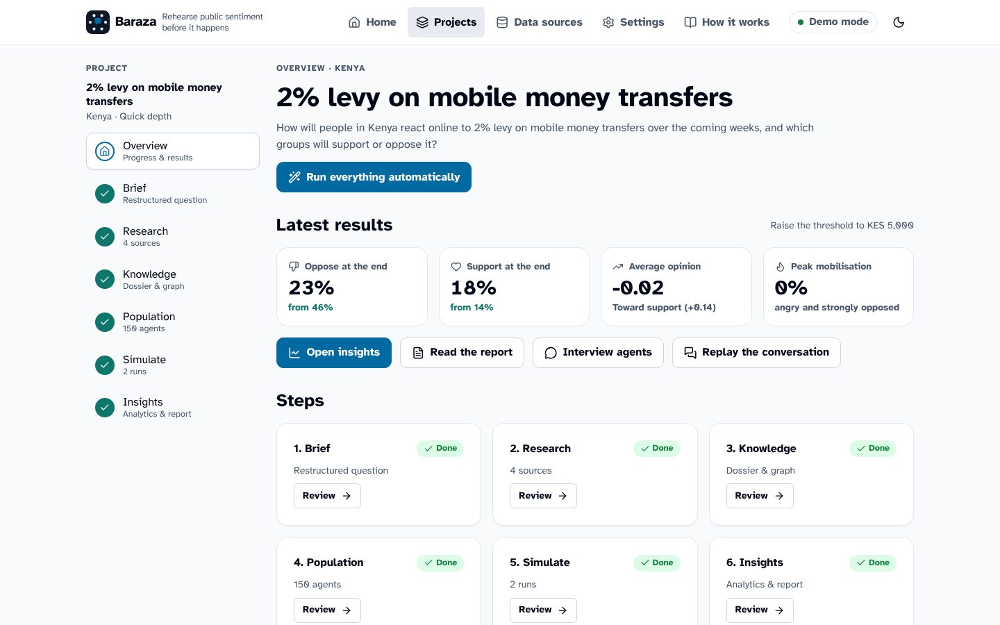
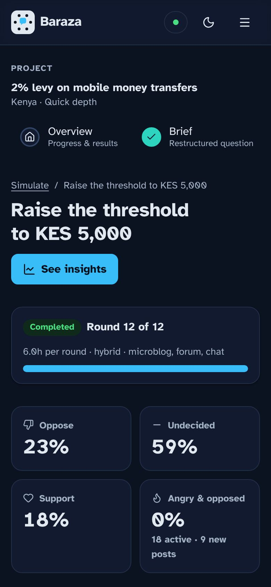
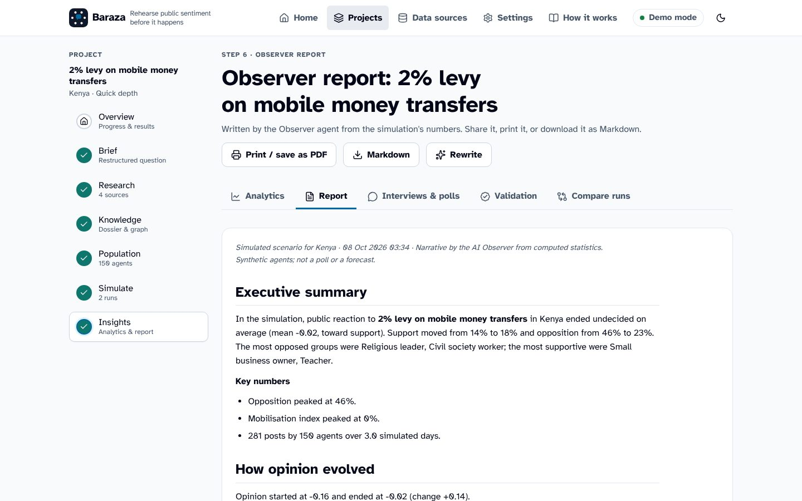
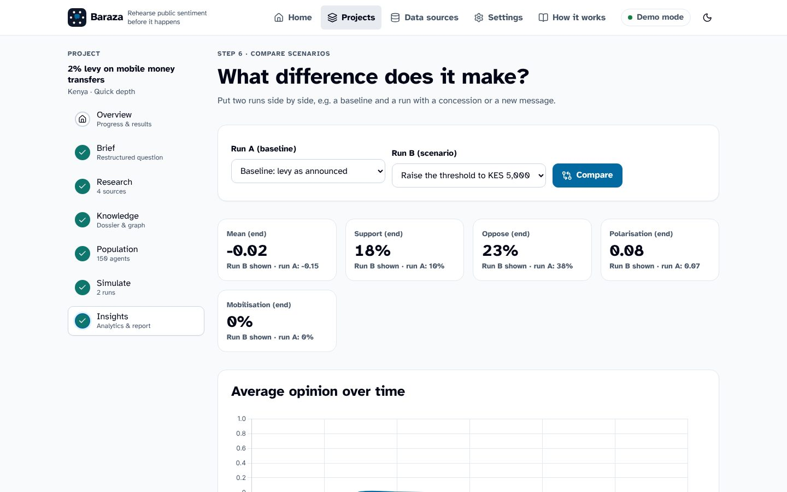

# User guide

Baraza guides you through six steps. Each project has a step bar (Brief, Research, Knowledge, Population, Simulate, Insights); a tick means the step is done. You can go back to any step at any time.

Baraza also works on phones, in light and dark themes:

## Home: start a rehearsal

Describe the policy, action or reform in one or two sentences, as you would explain it to a colleague. Good prompts say **what** changes, **who** proposes it, **for whom**, and optionally **what you want to know**:

> *The Kenya Revenue Authority will require all landlords to file monthly rental income tax through eTIMS from March, with penalties for late filing. How will landlords and tenants react online, and what message would reduce opposition?*

* **Country** sets demographics, regions, platforms, local news editions and the language of local search queries.
* **Depth** sets how much is researched and how many people are simulated: Quick (about 80 people), Standard (about 160) or Deep (about 300).
* **Agent language**: plain English, English with local expressions, or mixed English and local language (Swahili/Sheng in East Africa, Pidgin in Nigeria...).
* **More options → Focus regions** oversamples particular counties or regions.
* **Run full rehearsal** (Autopilot) runs all steps with sensible defaults; **Step by step** stops after the brief so you can check each stage.
* The **scenarios** below the form are ready-made examples from Kenya, Nigeria, South Africa and elsewhere.

Requests to incite violence or hatred or to target individuals are refused.

## Step 1: Brief ("Your question, made precise")

The AI restructures your prompt into a research brief. Check it carefully: everything downstream depends on it.

* **Title, refined question and summary.**
* **Policy details**: the concrete measures (rates, dates, who pays).
* **Who proposes it** and its **status**.
* **Who is affected, and how**: each group's impact, direction (harmed/benefits) and intensity. These drive the starting opinions of the population.
* **Stakeholders who will speak**: organisations with their likely positions and influence. They become institutional accounts.
* **Search queries**, local-language queries, social keywords and hashtags for each side.
* **Hypotheses**, assumptions and risks to watch.

Edit anything and press **Save changes** or **Approve and start research**. *Regenerate* throws the brief away and asks the AI again.

## Step 2: Research ("What people are already saying")

* **Search the web and social media**: choose sources (free ones are pre-selected; the *Data sources* page explains each), the time window, how much to read, and extra searches of your own. Research takes a few minutes; you can leave the page.
* **Add your own evidence**: a web address, pasted text (a press release, a WhatsApp forward, a Hansard extract), or files (PDF, Word, text, HTML, or a CSV export of posts).
* **Sources**: filter by platform, search, and open any source to read it. Untick sources that are irrelevant; excluded sources are ignored by later steps. *Bulk actions* exclude low-relevance items or delete excluded ones.
* **Public stance found so far**: the share of real posts labelled as supporting, opposing or neutral. With 15 or more labelled posts, the population can be calibrated to this.

## Step 3: Knowledge ("Research dossier and knowledge graph")

Press **Build knowledge base** to turn the evidence into (it also works from the brief alone if you have no sources):

* an **executive summary** with citations, **key facts**, a **timeline** and **open questions**;
* the **knowledge graph** of actors and their relationships (drag nodes; size shows importance) and **clusters of actors**;
* the **argument bank**: arguments for and against with their strength and tone. Agents use these arguments when they post. Add your own arguments (for example a message you want to test) or delete weak ones;
* **Search the evidence**: ask a question and get the most relevant passages and related actors.

## Step 4: Population ("The synthetic public")

**Create the population** with:

* **Number of people** and optional **focus regions**;
* **AI-written personas** (richer biographies for a sample of people);
* **Include institutions** (government bodies, parties, unions and associations from the knowledge graph, and media accounts);
* **Calibrate to real posts** and its strength;
* **Share of influencers**;
* **Coordinated accounts** (bots or paid bloggers), how many and which side they push;
* a **random seed** (same seed, same population).

The page shows starting opinions overall, by segment and by region group, *why segments start where they do*, and a searchable list of people. Click anyone to see their profile, personality, platforms, groups and opinion history across runs.

## Step 5: Simulate ("Run the swarm")

### New simulation

* **Scenario preset**: *Quick look* (12 rounds of 6 hours), *Standard* (24 × 4 hours), *Deep* (42 × 4 hours, one week) or *Instant* (no AI text, seconds).
* **Scheduled events**: add events at given rounds: breaking news, an official statement (message test), a policy change or concession, an influencer campaign, a rumour, a fact-check, or a *live web refresh* that pulls today's real headlines into the simulation. For each choose the message, who posts it, its position (-1 against .. +1 for), strength, duration and, for policy changes, who is affected.
* **Compare against**: link the run to a baseline for comparison.
* **Advanced settings (for researchers)**: rounds, hours per round, AI-written posts per round, text generation mode, platforms, echo-chamber feed strength, social influence, backfire effect, group polarisation, anchoring to first opinion, posts read per visit, overall activity and random seed. Defaults are reasonable; change them for sensitivity analysis.

### Watching a run

The run page updates live: average opinion and emotion, the share of supporters/opponents/neutrals over time, events, and **What people are posting** on the microblog, the forum and in group chats (click a post to see its thread and who was persuaded by it).

**Change the story** ("God mode") injects an event into the next round while the run is going. Runs can be **stopped** and **resumed**, **extended** by more rounds (*Extend by*), **run again with changes** (a copy with your new events, linked as a comparison), and **exported** (posts, people and per-round metrics as CSV, marked as simulated).

### Experiments: how sure can we be?

* **Monte Carlo ensemble**: repeat a scenario (and its baseline) many times with different random seeds to see the range of outcomes (10th-90th percentile bands) and 95% confidence intervals. Free and fast (template text only).
* **Parameter sweep**: vary one assumption (echo chambers, influence, backfire, group polarisation, anchoring, activity, share of coordinated accounts) to see whether your conclusions depend on it.

## Step 6: Insights

### Results dashboard

* **How people feel**: start and end distribution of opinions, support and opposition over time, opinion, emotion and sentiment trends.
* **Who supports, who opposes**: by segment, region group, age, gender, political leaning and urban/rural, with change.
* **Events and turning points**: what happened at each tipping point.
* **Which arguments persuaded, which backfired**: persuasion and backfire rates per 100 readers.
* **Most persuasive posts**, **most engaged posts**, **most influential accounts** and **people who changed most**.
* **Echo chambers**: the interaction network coloured by opinion, with modularity, the E-I index and cross-cutting exposure explained in plain language.
* **Hashtags and platforms**.

### Observer report

A written report: executive summary, how opinion evolved, who supports and who opposes, what drove opinion, polarisation and misinformation, risks and early-warning signals, recommendations, and confidence and limitations. Download it as Markdown or use **Print / save as PDF**.

### Interviews & polls

* **Interview a person**: ask any simulated person questions; they answer in character, from their persona, opinion history and what they read.
* **Ask the Observer**: questions about the whole run ("Why did boda boda riders turn against it in round 9?").
* **Virtual focus group**: a quick poll of a stratified sample with your own question and answer options, with results by segment and quotes.

### Validation

Compares simulated posts with real posts (from research or an uploaded CSV, for example from a past debate) on sentiment, stance and emotion distributions and vocabulary.

### Compare

Put two runs side by side: average opinion and the share opposed over time, and the biggest differences by segment. Use it to answer "what difference does a concession, a clarification or a fact-check make?"

## Other pages

* **Projects**: all projects; export a project as JSON, or delete it.
* **Data sources**: every connector with its cost, setup instructions and terms.
* **Settings**: language model (with a *Test the AI connection* button), API keys, research etiquette and AI usage across projects. Secrets are masked; leave a masked field unchanged to keep the stored value.
* **Background tasks**: everything running or finished, with logs; stop any task.
* **How it works**: a plain-language explanation of the method.

## Good practice

1. Spend two minutes on the brief: correct affected groups and their direction.
2. Read the dossier and the argument bank before simulating; delete arguments that are wrong, add the messages you want to test.
3. Start with a baseline run, then change one thing at a time and compare.
4. Before drawing conclusions, run an ensemble; before high-stakes decisions, test with real people too.
